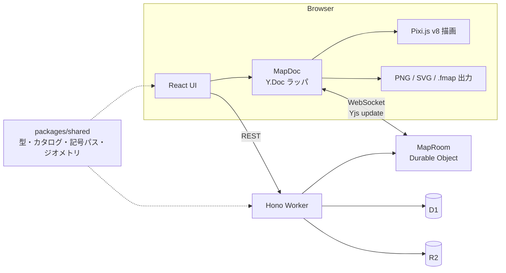

# MapCraft

国土地理院（GSI）の地図記号に準拠したデザインで、架空世界・創作地理の地図を複数人でリアルタイムに共同編集できるWebアプリ。

## 概要

小説・ゲーム・TRPG などの世界設定づくりでは、地図を描きたくても汎用の描画ツールでは「それらしい地図」に仕上げにくく、複数人での同時編集も難しい、という課題があります。MapCraft は、国土地理院の地図記号を116要素のカタログとして内蔵し、道路・鉄道・エリア・記号・ラベルを配置するだけで地形図風の地図を作れるようにします。地図データは CRDT（Yjs）で管理し、Cloudflare Durable Objects 上で同時編集を同期します。

> v2（全面再構築版）です。旧版（Pixi v7 + Supabase）は廃止済みです。

## 主な機能

- GSI風の地図描画: 線形・エリア・矩形・点記号・行政区分・自由配置テキスト
- 直線/曲線の切り替え（Catmull-Rom スプライン）と頂点編集
- スナップ（頂点・グリッド・角度）
- 道路の2層描画（casing + 本線）、鉄道の枕木自動生成、パターン充填エリア
- 地図記号カタログ 11カテゴリ・116要素（単一のSVGパス定義を Pixi 描画と SVG 出力で共有）
- レイヤー（表示/非表示・ロック・縮尺範囲）
- Undo / Redo、コピー/ペースト/複製、矩形選択、ナッジ
- リアルタイム共同編集（Yjs + Durable Objects）、リモートカーソル、プレゼンス
- 共有リンク（閲覧専用 / 編集可）
- 自動同期（保存操作不要）、Google OAuth 認証、マップ管理
- エクスポート: PNG / SVG / .fmap（.fmap はインポート可）、サムネイル自動生成

## 技術スタック

| 役割 | 技術 |
|------|------|
| フロントエンド | React 19 + TypeScript (strict) + Vite + Tailwind CSS v4 |
| 描画 | Pixi.js v8（WebGL） |
| 地図データ | Yjs の Y.Doc を単一情報源とし、UI状態のみ Zustand |
| 同時編集 | Yjs + Cloudflare Durable Objects（1マップ=1DO、WebSocket hibernation） |
| バックエンド | Hono on Cloudflare Workers（静的アセットも同一Workerで配信） |
| ストレージ | D1（メタデータ）/ DO SQLite（地図データ）/ R2（サムネイル） |
| 認証 | better-auth（Google OAuth） |
| テスト | Vitest / Playwright |
| モノレポ | pnpm workspaces |

## アーキテクチャ



設計上の主な方針（`CLAUDE.md` に明文化）:

- 地図データの読み書きは `MapDoc` 経由のみ。コンポーネントから Y.Doc を直接触らない
- 記号形状は SVG パス文字列を単一ソースにし、Pixi 描画と SVG 出力の食い違いを構造的に防ぐ
- Durable Object は Y.Doc をインスタンス化せず、update バイナリの merge/diff のみで応答する（hibernation と両立させるため）
- ジオメトリ計算は Pixi 非依存の純関数として `packages/shared` に置く

## セットアップと起動

前提: Node.js 20+、pnpm 9+。Cloudflare リソース作成や Google OAuth の設定は [SETUP.md](./SETUP.md) を参照してください。

```bash
pnpm install
cp apps/worker/.dev.vars.example apps/worker/.dev.vars   # 値を埋める（SETUP.md 参照）
pnpm db:migrate:local
pnpm dev   # web: http://localhost:5173 / worker: http://localhost:8787
```

OAuth 未設定でも、開発専用の `/dev/editor`（認証不要）でエディタを試せます。

| コマンド | 内容 |
|---------|------|
| `pnpm dev` | web / worker を並列起動 |
| `pnpm build` | shared → web → worker の順にビルド |
| `pnpm check` | 型チェック + Vitest |
| `pnpm e2e` | Playwright E2E（4シナリオ） |
| `pnpm e2e:perf` | 性能計測（5,000オブジェクトを投入） |
| `pnpm db:migrate:local` / `pnpm db:migrate:remote` | D1 マイグレーション |

## ディレクトリ構成

```
apps/
  web/src/        React アプリ（app / auth / dashboard / editor / export）
    editor/       canvas(Pixi) / tools / doc(MapDoc) / ui / state
  worker/src/     Hono + Durable Objects（auth / db / routes / rooms / middleware）
packages/shared/  型・カタログ・記号パス・ジオメトリ・.fmap スキーマ
e2e/              Playwright E2E
scripts/          性能計測スクリプト
docs/             計画書・実装書・逸脱ログ
```

## Claude Code での開発

このプロジェクトは Claude Code と「計画 → 実装 → 検証」の順で進めました。

- 計画: 先に `docs/v2-plan.md`（計画書）と `docs/v2-implementation.md`（約800行の実装書。仕様、マイルストーン M0〜M10、完了条件、検証ゲート）を作成
- 実装: `CLAUDE.md` に設計上の守るべき原則（データアクセス経路、Pixi v8 の作法、DO の制約など）を記載し、マイルストーン単位で実装
- 記録: 仕様どおりに実装できなかった点と代替案、実測結果を `docs/v2-decisions.md` に逸脱ログとして記録
- 検証: Vitest の単体テストと、Playwright の E2E 4本（描画の永続化 / 2クライアント同時編集 / 閲覧専用リンク / .fmap 往復）、5,000オブジェクトでの性能計測スクリプトを用意。変更時の最低ゲートは `pnpm check`

## ライセンス

未定
